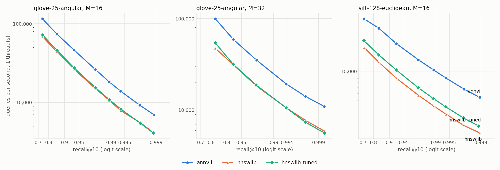
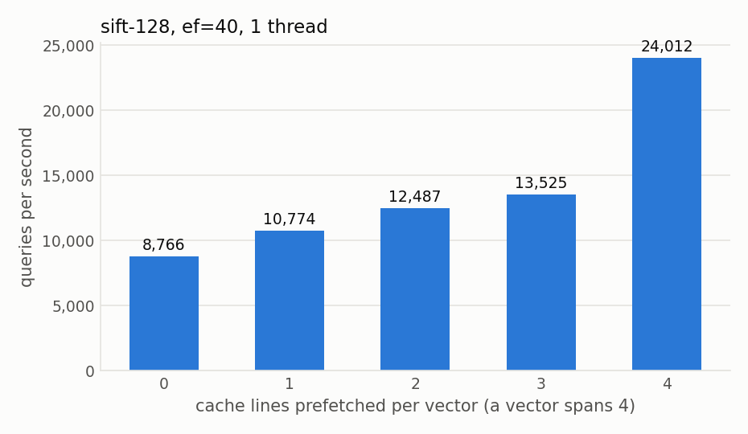
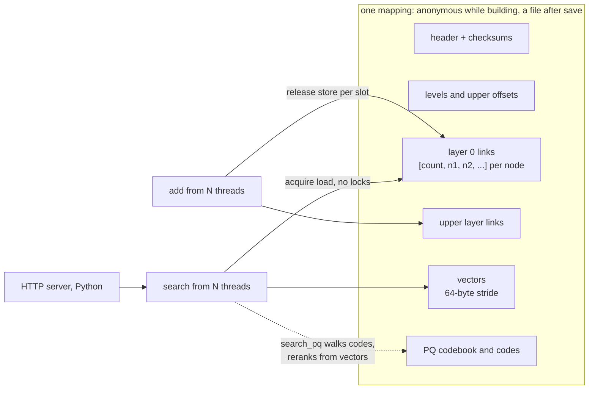

# annvil

[](https://github.com/matejpopovski/annvil/actions/workflows/ci.yml)

An HNSW vector search engine in C++20, hammered into shape against
[hnswlib](https://github.com/nmslib/hnswlib) on an Apple M3 Max. The index is a set of flat arrays
that are the same in memory and on disk, so opening one is an `mmap`. Reads take no locks, even
while inserts are running. It also has product quantization, a small HTTP server and Python
bindings.

On the two standard ann-benchmarks datasets it builds an equivalent graph to hnswlib 0.8.0 and
searches it 1.7 to 3.1 times faster at the same recall, one thread:

<picture>
  <source media="(prefers-color-scheme: dark)" srcset="results/plots/recall-qps-1t-dark.png">
  
</picture>

| dataset | recall@10 | annvil | hnswlib-tuned | hnswlib 0.8.0 | annvil / hnswlib |
|---|---|---|---|---|---|
| glove-25-angular, M=16 | 0.95 | 38,406 | 22,770 | 21,907 | 1.75 |
| glove-25-angular, M=16 | 0.99 | 17,251 | 10,264 | 10,022 | 1.72 |
| glove-25-angular, M=32 | 0.95 | 46,188 | 24,585 | 24,203 | 1.91 |
| glove-25-angular, M=32 | 0.99 | 22,519 | 12,210 | 12,149 | 1.85 |
| sift-128-euclidean, M=16 | 0.95 | 18,806 | 8,042 | 6,295 | 2.99 |
| sift-128-euclidean, M=16 | 0.99 | 9,791 | 3,980 | 3,180 | 3.08 |

Queries per second, interpolated between ef settings. Same machine, same session, same M and
efConstruction, engines interleaved within one process. Every number in this file is in
[`results/summary.md`](results/summary.md), generated from the CSVs beside it. How they were
measured, and what the machine was doing at the time, is in [BENCHMARKS.md](BENCHMARKS.md).

These numbers are specific to one CPU. hnswlib has hand-written SSE and AVX code that this
comparison never exercises, because on ARM all of it is compiled out. Nothing here says anything
about x86.

## Comparing against hnswlib honestly

A plain comparison on ARM would be unfair to hnswlib, because its SIMD and its prefetches are
both behind `#ifdef USE_SSE` and simply vanish. So there are two hnswlib engines. `hnswlib` is the
0.8.0 release, built with the flags its own CMakeLists asks for. `hnswlib-tuned` is the same
source with three changes that all favour it: prefetches restored, prefetches widened to cover the
whole vector, and annvil's own NEON kernels plugged in through its public `SpaceInterface`. The
exact delta is a few lines of [`bench/CMakeLists.txt`](bench/CMakeLists.txt).

The two graphs are equivalent, which is the precondition for comparing speed at all. At equal ef,
recall stays within 0.004 of hnswlib and distance computations within 4.5%, across every
configuration. annvil is not winning by doing less work per query.

## Where the time goes

The obvious story for a NEON engine is that the NEON is what makes it fast. It is not.

| ns per distance, data in L1 | annvil NEON | hnswlib, auto-vectorized | scalar |
|---|---|---|---|
| dim 25, L2 | 2.64 | 3.29 | 4.56 |
| dim 128, L2 | 7.05 | **6.67** | 49.40 |
| dim 128, dot | 6.43 | 6.57 | 42.33 |
| dim 960, dot | 51.33 | **48.28** | 614.58 |

hnswlib's plain C++ loop, compiled with `-ffast-math`, comes out as the same four-way unrolled
`fsub.4s` loop as the hand-written kernel (visible in the disassembly), and it is slightly faster
at some sizes. Hand-written NEON is not where this engine's advantage comes from. What the
kernels do buy is freedom from `-ffast-math`: the library is compiled without it.

The time goes to memory. A sift-128 vector is 512 bytes, which is four of the M3's 128-byte cache
lines, and a query computes around 900 distances at ef=40. With one line prefetched, as hnswlib's
call sites do, each distance costs far more than the 7 ns of arithmetic.

<picture>
  <source media="(prefers-color-scheme: dark)" srcset="results/plots/prefetch-dark.png">
  
</picture>

Prefetching the whole vector more than doubles QPS over one line, from 10,774 to 24,012 on the
same index. The shape is the interesting part: lines one to three add little, and the last one
adds most of it. That fits every vector with any line missing still paying a full memory round
trip, so the stall only goes away when all four are covered. This is inferred from the curve, not
from counting stall cycles.

*When* the prefetch happens matters as much as how far it reaches. hnswlib prefetches the next
neighbour just before computing the current one. annvil filters the whole neighbour list first and
prefetches everything unvisited before the first distance, so the fetches overlap. Patching
hnswlib's loop into annvil, with nothing else changed ([`bench/one_ahead_prefetch.patch`](bench/one_ahead_prefetch.patch)):

| dataset | ef | all neighbours first | one ahead | ratio |
|---|---|---|---|---|
| glove-25-angular | 160 | 15,346 | 10,297 | 1.49 |
| sift-128-euclidean | 160 | 10,160 | 5,532 | 1.84 |

That accounts for most of annvil's lead over `hnswlib-tuned` (about 1.7x on glove, 2.3x on sift).
What is left is roughly 1.15x to 1.3x, shared between a visited bitset instead of 16-bit tags, one
sorted beam instead of two heaps, and vectors stored apart from links and aligned to cache lines.
Those were not measured separately. Nothing stops hnswlib from adopting the same loop.

## Where hnswlib wins

- **It has features annvil does not.** `markDelete`, `resizeIndex`, inserting into a loaded index,
  filtered search, and Windows support. annvil's capacity is fixed at creation and a saved index
  is read-only.
- **Latency right after startup.** Opening is a page-table operation, but the faults still have to
  happen somewhere. With the page cache warm, annvil's first 1,000 queries take 32% to 41% longer
  than its second 1,000. hnswlib's two passes are identical because `loadIndex` already paid for
  everything. annvil still wins open plus first queries by a wide margin here (95 ms against
  1,641 ms on sift), but a truly cold file on a slow disk was not measured, and there hnswlib's
  eager read may be the better behaviour.
- **Raw kernel speed, at some dimensions.** See the table above. The margin is about 5%, and the
  compiler earned it.
- **Files are smaller on low-dimensional data.** annvil pads each vector to a 64-byte multiple, so
  glove's 100 bytes take 128, one cache line. The glove M=16 index is 313 MiB against 281 MiB.
  In RAM the comparison reverses (313 MiB against an estimated 397 MiB), because hnswlib's mutexes
  and label map are not in its file.
- **Maturity.** hnswlib has years of use behind it. annvil has this benchmark and its tests.

## How it is built



**One layout, two owners.** Build-time storage is an anonymous `mmap`, read-time storage is a file
`mmap`, and the search code cannot tell them apart. There is no serializer to keep in sync, and
`open` on a 660 MB index takes milliseconds. The rejected alternative was hnswlib's
per-node malloc for upper layers, which is simple but makes persistence a copy.

**Levels are a hash of (seed, id).** Tabulating them at construction fixes the size of every array
before the first insert. That removes reallocation from the write path, which was the only reason
a reader would have needed a lock. The cost is a fixed capacity.

**Readers never block.** Each link slot is stored with release after the node it names is complete,
and loaded with acquire, which on this CPU is one `LDAPR`. Slots are never cleared and nodes are
never removed, so a reader holding a stale count sees old but valid ids. A reader racing a writer
may miss the newest point or follow a stale edge, but only ever dereferences finished nodes.
Writers take one striped lock per neighbour list, and never hold two.

**Nodes are linked bottom-up.** See the next section.

**A sorted beam replaces two heaps.** Algorithm 2 keeps a candidate heap and a result heap, but a
candidate outside the top ef can never be expanded, so one sorted array of 8-byte entries with a
cursor does both jobs.

**Search is templated on a distance oracle,** so exact and PQ traversal share one implementation
and each inlines its own distance. Instrumentation is a wrapper type rather than a branch in the
hot loop.

**Corrupt files fail cleanly.** The header is checksummed and every size in it is validated against
the file before anything is dereferenced. `verify()` checks the payload checksum and every link,
and `annvil serve` runs it at startup. A test flips random bits across a saved index and asserts
that each flip inside a section is caught.

## The bug the benchmark would not have shown

The first version linked each level as it descended, as the paper describes. Concurrently that
publishes a node on level l+1 before its level l list exists. Another insert descending through it
lands on an empty list and its whole layer search dead-ends. hnswlib prevents this by holding the
node's lock for the whole insertion and taking that lock on every read during a build. annvil's
readers do not lock, so instead all levels are searched first and linked from the bottom up: by
the time a node is reachable on a level, every level below it is complete.

The test that exposed this started out misleading. It compared one parallel build against one
serial build, flaked at about one run in nine, and "passed" after the fix partly by luck, because a
single parallel build is a poor sample. 100 builds per variant on 4,000 clustered points, 8 threads:

| linking | mean recall | min | max | builds with unreachable nodes | worst case |
|---|---|---|---|---|---|
| annvil, top-down | 0.9455 | 0.896 | 0.970 | 100 of 100 | 61 nodes |
| annvil, bottom-up | 0.9586 | 0.926 | 0.978 | 88 of 100 | 2 nodes |
| hnswlib | 0.9510 | 0.916 | 0.976 | not measured | |

The real damage was unreachable nodes, not recall. It also showed that the wide spread between
builds is a property of parallel HNSW on small graphs, shared with hnswlib, and not an annvil bug.
The test now averages several builds and separately asserts reachability, and it was confirmed to
fail against the top-down code. Serial builds reach 0.978 here and hnswlib's reaches 0.984, one
deterministic sample each.

## Things that did not earn their place

**Breadth-first reordering.** `reorder()` renumbers nodes so neighbours sit together in memory, and
`annvil-bfs` measures it. It came out between 0.94x and 1.02x of plain annvil, so it is no gain on
these datasets at this size, and it costs a second copy of the index while it runs. The code stays
because the measurement is the point, but it is off by default.

**`keepPrunedConnections`.** The paper's option to refill lists from pruned candidates gave 1% to
9% more QPS at equal recall. It is implemented but off by default, to keep the same parameters
meaning the same graph as hnswlib in this comparison.

## Product quantization

Graph traversal can run on PQ codes alone, with the best candidates rescored from the full vectors.
PQ here is a memory trade and never a speed win. The best QPS reaching recall 0.95, one thread:

| dataset | traversal uses | ef / rerank | recall | QPS | links + codes or vectors |
|---|---|---|---|---|---|
| sift-128 | full vectors | 64 / none | 0.9643 | 16,908 | 623 MiB |
| sift-128 | PQ, 32 bytes | 64 / 64 | 0.9542 | 15,091 | 166 MiB |
| sift-128 | PQ, 16 bytes | 128 / 128 | 0.9702 | 10,784 | 150 MiB |
| sift-128 | PQ, 8 bytes | | best reached 0.9212 | | 143 MiB |
| glove-25 | full vectors | 64 / none | 0.9678 | 27,589 | 304 MiB |
| glove-25 | PQ, 16 bytes | 64 / 64 | 0.9505 | 23,373 | 178 MiB |
| glove-25 | PQ, 10 bytes | 256 / 256 | 0.9747 | 7,200 | 171 MiB |
| glove-25 | PQ, 5 bytes | | best reached 0.7193 | | 165 MiB |

The memory column is computed from section sizes, not measured, and reranking still reads the
vector section. So this shows what can stay out of RAM between reranks, not a measured RSS. The
intended setup is the vectors paged out on SSD, and that was not benchmarked. 5 bytes on glove and
8 bytes on sift are simply too coarse: no ef in the sweep reached 0.95 with them. At these sizes
the links dominate memory anyway, at 135 MiB on sift against 15 MiB of 16-byte codes.

## Running it

Needs CMake 3.24 or newer and a C++20 compiler. Dependencies are fetched at pinned versions and
hashes. Python parts use [uv](https://docs.astral.sh/uv/).

```sh
cmake --preset dev && cmake --build --preset dev -j 8
ctest --preset dev

cmake --preset asan && cmake --build --preset asan -j 8 && ctest --preset asan   # ASan + UBSan
cmake --preset tsan && cmake --build --preset tsan -j 8 && ctest --preset tsan   # ThreadSanitizer

uv sync && uv run pytest -q     # builds the Python module and runs its tests
```

The test suite is 53 doctest cases and 15 pytest cases. Weakening the link slots to relaxed
ordering makes ThreadSanitizer report races in these tests, so the clean result means something.

From Python:

```python
import annvil, numpy as np

index = annvil.Index(dim=128, capacity=len(vectors), metric="l2", M=16, ef_construction=200)
index.add(vectors, threads=8)
index.save("vectors.annvil")

mapped = annvil.Index.open("vectors.annvil")      # read-only, returns in milliseconds
labels, distances = mapped.search(queries, k=10, ef=100, threads=8)
```

From the command line, against a dataset fetched as described below:

```sh
./build/dev/annvil build --dataset data/sift-128-euclidean.annb --out sift.annvil --threads 8
./build/dev/annvil verify sift.annvil
./build/dev/annvil recall --index sift.annvil --dataset data/sift-128-euclidean.annb --ef 100
./build/dev/annvil serve  --index sift.annvil --port 8080

curl -s localhost:8080/v1/search -d '{"vector": [1, 3, 11, 110, ...], "k": 3, "ef": 64}'
# {"results":[{"distance":54229.0,"label":932085},{"distance":55091.0,"label":934876},...]}
```

The server binds to localhost, has no authentication and no TLS, and validates all input before it
reaches the index. It serves `GET /health`, `GET /v1/info` and `POST /v1/search`.

To reproduce the benchmarks (about two hours, and 7 GB for indexes):

```sh
uv sync
./scripts/download_datasets.sh
cmake --preset bench && cmake --build --preset bench -j 8
uv run python bench/run_benchmarks.py
uv run python bench/plot_results.py
```

## Limitations

- No deletes, no updates, no filtered search, no growth past the capacity set at creation, and a
  saved index cannot take more inserts.
- Benchmarked on one Apple M3 Max only. The x86 kernels are chosen at compile time with no runtime
  dispatch, are tested for correctness, and have never been benchmarked.
- Built and tested with Apple clang only. CI uses clang on Linux. GCC has not been tried, and the
  CI workflow itself has not yet run, because this repository has not been pushed.
- POSIX only, because storage is `mmap`. Files are little-endian and refuse to open elsewhere.
- PQ is fixed at 8 bits per subspace. Training samples 65,536 vectors and has no OPQ-style rotation.
- `open` validates the header and sizes but not the links, unless `verify` is requested. A
  deliberately crafted file that passes the header checks can cause out-of-bounds reads if searched
  without verification. `annvil serve` always verifies.
- `save` needs writers stopped. `reorder` and `attach_pq` replace storage and need everything
  stopped.
- The HTTP server was not load-tested and its throughput is not reported.
- A process that uses many indexes of different sizes keeps the largest visited set per thread
  until the thread exits.

## Data

Datasets come from [ann-benchmarks](https://ann-benchmarks.com/) (MIT-licensed project) and are not
in this repository. `scripts/download_datasets.sh` fetches them and flattens the HDF5 into the
`.annb` format the harness maps directly.

- **glove-25-angular**: 1,183,514 vectors, 25 dimensions, from
  [GloVe](https://nlp.stanford.edu/projects/glove/) by Pennington, Socher and Manning, under the
  Public Domain Dedication and License.
- **sift-128-euclidean**: 1,000,000 vectors, 128 dimensions, ANN_SIFT1M from
  [Corpus TEXMEX](http://corpus-texmex.irisa.fr/) by Jégou, Douze and Schmid, whose authors waived
  all copyright.

HNSW is by Malkov and Yashunin, "Efficient and robust approximate nearest neighbor search using
Hierarchical Navigable Small World graphs", TPAMI 2020. MIT licensed, see [LICENSE](LICENSE).
